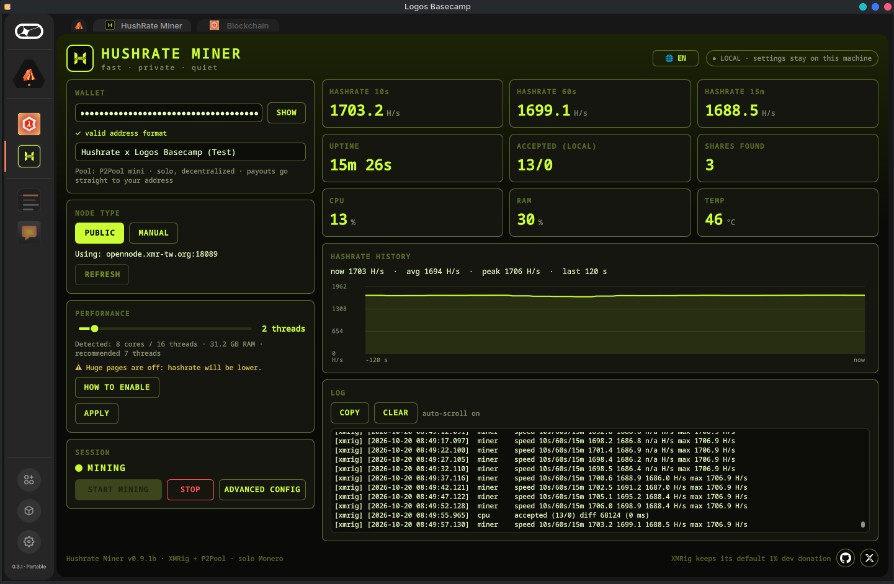

# Hushrate Miner

Solo Monero (XMR) mining for [Logos Basecamp](https://logos.co). Hushrate Miner runs
[P2Pool](https://github.com/SChernykh/p2pool) and [XMRig](https://github.com/xmrig/xmrig)
behind a single page: paste your address, press start. Payouts go straight to your own
wallet. There is no account, no custody and no pool operator.

Version 0.9.1b (beta)



## Features

- One page for wallet, node, threads, start and stop
- Live hashrate (10 s, 60 s, 15 min), uptime, CPU, RAM and temperature, with a history chart
- Public node mode that probes the public node list and uses only nodes that answer on both
  RPC and ZMQ, which P2Pool requires. Manual mode tries your own node first, with an optional
  public fallback
- Temperature limit with automatic pause, silent mode and pause on battery
- Huge pages guide with copyable commands
- Update notice for XMRig and P2Pool
- 14 languages: English, Spanish, French, German, Portuguese, Russian, Chinese, Japanese,
  Arabic, Turkish, Korean, Italian, Indonesian and Hindi

## Installation

### From the package catalog

1. Open Basecamp and go to Package Manager, then Add repository
2. Paste this URL:

```
https://raw.githubusercontent.com/MrCrypPrivacy/HushrateMiner-Catalog/refs/heads/main/logos-repo.json
```

3. Install `hushrate_miner`. It needs the core module `hushrate_core`; if Basecamp does not
   install it automatically, install `hushrate_core` first
4. Open `hushrate_miner` in the sidebar. If it is not listed, go to Settings, Module
   Inspector and load it

The packages in the catalog are not signed yet.

### From a release

Download these files from the [latest release](../../releases/latest):

| File | Purpose |
| --- | --- |
| `hushrate-core-<version>.lgx` | Core module (runs and controls the miner) |
| `hushrate-miner-ui-<version>.lgx` | User interface |
| `SHA256SUMS` | Checksums to verify the downloads |

Verify them, then install both in Logos Basecamp, core first:

```
sha256sum -c SHA256SUMS
```

1. Open Basecamp and go to Package Manager, then Install Local Package
2. Select `hushrate-core-<version>.lgx`
3. Install `hushrate-miner-ui-<version>.lgx` the same way
4. Open `hushrate_miner` in the sidebar. If it is not listed, go to Settings, Module
   Inspector and load it

### Requirements

- Logos Basecamp (official release or development build)
- Linux x86_64, with `curl`, `gpg` and `tar` installed

Linux x86_64 is the only supported platform at the moment. Windows and macOS support is planned.

## Usage

1. On first launch, press **DOWNLOAD**. XMRig and P2Pool are fetched from their official
   GitHub releases and verified before use
2. Paste your primary Monero address (starts with 4)
3. Choose the number of threads. The recommended value is preselected
4. Press **START MINING**

Mining continues until you press **STOP** or close Basecamp. Settings are saved automatically.

## Security

- XMRig and P2Pool are not bundled. Each download is accepted only if its GPG signature
  matches the developer key pinned in this source code and its SHA256 matches the signed
  checksums
- Both binaries are checked again against a local manifest before every start
- Settings are stored as plain text with permissions 0600 in
  `~/.local/share/hushrate/config.txt`. They are not encrypted
- XMRig keeps its default 1% development donation

## Building from source

Requires Nix with flakes enabled, git and python3.

```
./miner.sh prepare    # build the core and UI packages
./miner.sh run        # open the Basecamp dev build with both installed
./miner.sh package    # collect the portable .lgx files and SHA256SUMS in dist/
```

Run the core test suite (needs `g++`, `gpg`, `curl` and `python3`; it uses fake releases and
fake miners, and does not touch the network):

```
bash test/run_tests.sh /tmp/hushrate-test
```

Repository layout:

```
module/src/   C++ core
ui/           QML interface source
assets/       icons and logo
tools/        UI builder and translations
test/         core test suite
miner.sh      build script
```

## Disclaimer

Mining uses CPU and power and produces heat. Use it at your own risk. Earnings are not
guaranteed.

## License

Proprietary, all rights reserved. See [LICENSE](LICENSE). You may read the code and build it
for your own personal use. Redistribution and sale are not allowed.
